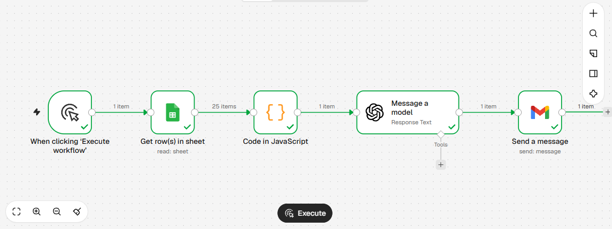
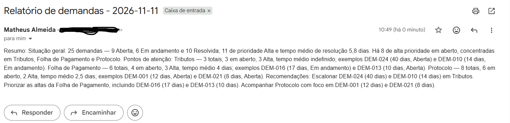

# Relatório de demandas com n8n e IA

Fluxo de automação no n8n que lê demandas de suporte numa planilha, calcula indicadores, usa IA para redigir uma análise e envia o relatório por e-mail.

Este projeto continua o [painel de demandas de suporte](https://github.com/matheusatec/painel-demandas-suporte): o painel mostra os dados, e este fluxo os interpreta.

> Todos os dados são **fictícios**, criados para a demonstração. Nenhuma informação real de órgão ou pessoa foi usada.

## Problema

Os dados de demandas de suporte ficam em painéis e planilhas, mas alguém precisa olhar, calcular e escrever o resumo para o gestor. Esse trabalho é repetitivo e fácil de atrasar.

## Solução

Um fluxo no n8n, em cinco etapas:

1. **Gatilho manual** inicia o fluxo.
2. **Google Sheets** lê as 25 demandas da planilha.
3. **Código em JavaScript** calcula os indicadores. Os números vêm do código, não da IA.
4. **IA (GPT-5 mini)** recebe os números já calculados e escreve a análise: resumo, pontos de atenção e recomendações.
5. **Gmail** envia o relatório por e-mail.



### Indicadores calculados pelo código

- total de demandas e distribuição por status e por prioridade;
- demandas de prioridade Alta ainda em aberto;
- tempo médio de resolução, geral e por sistema;
- por sistema: total, em aberto e prioridade Alta em aberto;
- demandas de prioridade Alta em aberto há mais de 7 dias.

"Em aberto" significa **Aberta mais Em andamento** (tudo que não está Resolvida).

### Por que o código calcula e a IA só escreve

Modelos de linguagem erram contas. Por isso a divisão: o JavaScript faz toda a matemática e entrega à IA um resumo pronto, e a IA só interpreta e redige. Isso reduz o risco de números inventados e torna o resultado verificável.

## Exemplo de resultado



## Validação da saída da IA

A análise gerada foi conferida contra os dados, número por número. O processo encontrou problemas que foram corrigidos:

| Problema encontrado | Correção |
|---|---|
| A IA confundiu "9 demandas com status Aberta" com "demandas de prioridade Alta em aberto" | Criei o campo `alta_prioridade_em_aberto` no código (valor 8) para a IA não ter de deduzir |
| Formato ilegível ("17/10/9 dias") | Regra de formato no prompt: `DEM-016 (17 dias)` |
| Hipótese contrária aos dados (sugeriu falta de equipe em Protocolo, que é o sistema que resolve mais rápido) | Regra: causas só como "hipótese" e coerentes com os números |
| Recomendação de realocar equipe de Contabilidade, que é o sistema mais lento | Regra: recomendar apenas escalonar, priorizar e acompanhar |
| Texto com termos inventados ("SLA crítico", "bloqueios") e acima do limite de palavras | Proibi os termos inventados. O limite de palavras continua sendo ultrapassado (ver limitações) |
| Uma regra de vocabulário fez a IA chamar "Em andamento" de "não resolvidas" | Regra substituída: usar os nomes exatos dos status |

Na versão final, os números do e-mail foram conferidos contra a saída do bloco de código: totais por status, por prioridade, por sistema, tempo médio e dias de cada demanda citada.

### Limitações conhecidas

- A IA ainda pode acrescentar hipóteses de causa ou risco que os dados não sustentam (por exemplo, "impacto fiscal" para o sistema Tributos). Por isso a saída **deve ser revisada por uma pessoa** antes de ser enviada a um gestor.
- A IA pode misturar os termos "aberta" e "em aberto". O código usa "em aberto" para Aberta mais Em andamento.
- A IA nem sempre respeita o limite de palavras pedido no prompt (a versão final ficou com cerca de 190 palavras para um limite de 150).
- O gatilho é **manual**. Não há agendamento semanal automático (seria o próximo passo).
- Os dias em aberto são calculados a partir da data de execução. Quem rodar em outra data verá valores diferentes dos do exemplo, que foi gerado em 11/11/2026.

## Como rodar

1. Importe o arquivo `Relatorio de demandas com IA.json` no n8n (menu do fluxo, **Import from file**).
2. Crie uma planilha no Google Sheets com os dados de `demandas-ficticias.csv` e uma aba chamada `demandas`.
3. No bloco **Get row(s) in sheet**, selecione a sua planilha.
4. Configure as credenciais do Google (Sheets e Gmail) e da OpenAI no n8n. As credenciais não vão no arquivo exportado.
5. No bloco **Send a message**, troque o destinatário pelo seu e-mail.
6. Clique em **Execute workflow**.

## Estrutura do repositório

```
├── README.md
├── Relatorio de demandas com IA.json   (fluxo do n8n)
├── demandas-ficticias.csv              (dados fictícios)
├── fluxo.png                           (print do fluxo)
└── tela-email.png                      (print do e-mail recebido)
```

## Tecnologias

n8n, Google Sheets, JavaScript, OpenAI (GPT-5 mini), Gmail.

## Autor

Matheus Nascimento de Almeida
[LinkedIn](https://linkedin.com/in/matheusatecc) · [GitHub](https://github.com/matheusatec)
